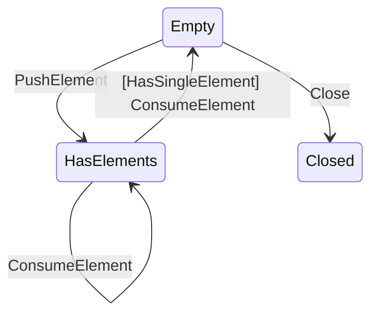

<!---
Autogenerated. Do not modify.

This file can be regenerated by running
go run github.com/arnavdugar/hsm/codegen -i=machine.yaml -o go=machine.go -o typescript=machine.ts -o mermaid=machine.md
--->
# State Machine

